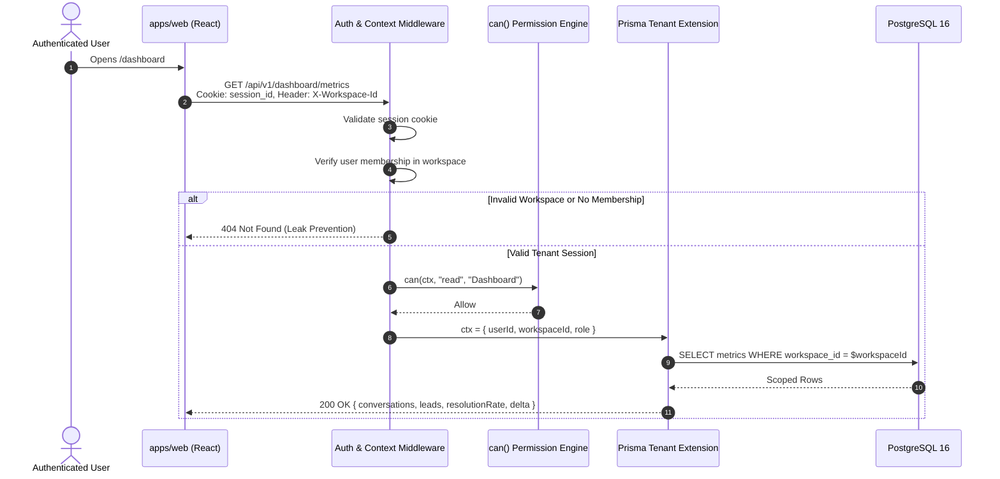
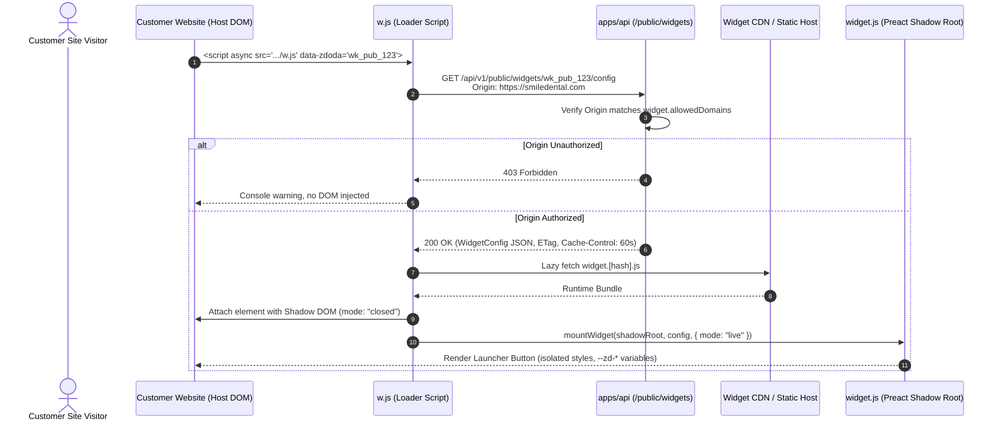
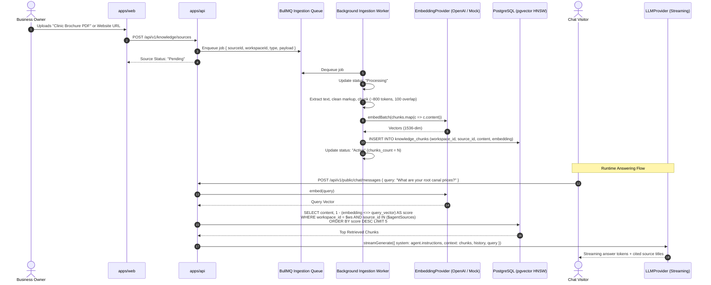
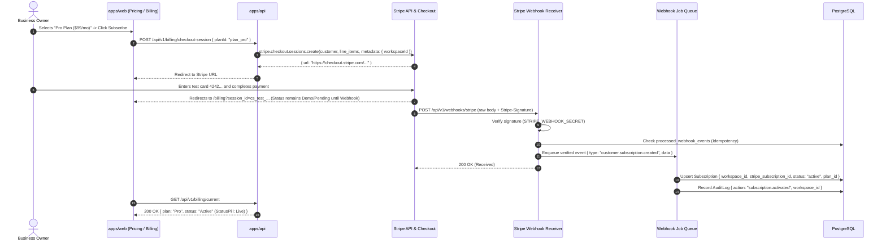
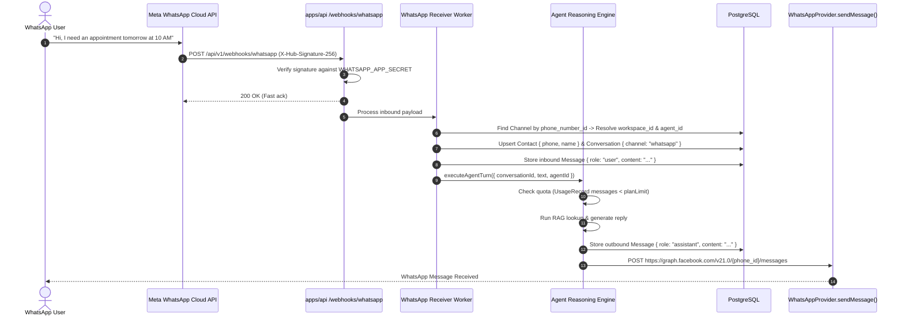
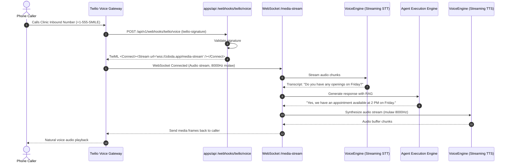

# Zdoda System Architecture

This document describes the high-level system architecture, monorepo package layout, data flow sequences, and provider abstractions for **Zdoda: One Agent. Every Channel.**

---

## 1. Monorepo Organization & Rationale

Zdoda is structured as a pnpm workspace orchestrated by Turborepo:

```
zdoda/
├── apps/
│   ├── web/               # Customer dashboard, admin app, landing page (React 19, Vite, Tailwind v4)
│   └── api/               # REST API & WebSocket/SSE server (Node, Express, TypeScript, Prisma)
├── packages/
│   ├── shared/            # Zod schemas, TypeScript contracts, WidgetConfig, plan quotas
│   ├── ui/                # Apple-inspired design system kit (Radix, Tailwind v4, Lucide, Motion)
│   ├── widget/            # Embeddable chat widget runtime (Preact, Shadow DOM, lib mode build)
│   └── db/                # Prisma schema, migrations, seed scripts, client extensions
├── docs/                  # Architectural specs, data models, progress, guides
├── .agents/               # Antigravity rules and phase execution workflows
├── docker-compose.yml     # Local services: PostgreSQL + pgvector, Redis, Mailpit, MinIO
└── turbo.json             # Monorepo build and pipeline cache configurations
```

### Rationale
- **Single Source of Truth (`packages/shared`):** The `WidgetConfigV1` and DTO schemas are imported directly by `apps/web` (studio form), `packages/widget` (runtime renderer), and `apps/api` (validation & storage). Contract mismatches are caught at compile time.
- **Shared UI Kit (`packages/ui`):** Enforces the Apple two-layer design language (opaque content layer + glass functional layer) across the entire customer web app.
- **Zero-Dependency Widget Runtime (`packages/widget`):** Built with Preact for maximum lightweight performance (loader ≤ 8 KB gzip, runtime ≤ 45 KB gzip). Rendered inside a closed Shadow DOM to guarantee zero CSS collisions with host websites.
- **Unified Tenancy & Database (`packages/db`):** Centralizes the Prisma client extension enforcing workspace isolation across all API endpoints.

---

## 2. System Flow Diagrams (Mermaid)

### Flow 1: Tenant-Scoped Dashboard Request



---

### Flow 2: Chat Widget Load on Customer Site



---

### Flow 3: RAG Ingestion and Answering Pipeline



---

### Flow 4: Stripe Checkout, Webhook & Subscription Sync



---

### Flow 5: WhatsApp Inbound Webhook -> Agent -> Reply



---

### Flow 6: Voice Call Pipeline (Twilio -> STT -> Agent -> TTS)



---

## 3. Provider Interfaces & Port-Adapter Architecture

All external integrations adhere to port-and-adapter interfaces located in `apps/api/src/providers/`.

### 1. LLMProvider (`apps/api/src/providers/llm/`)
```typescript
export interface LLMMessage {
  role: 'system' | 'user' | 'assistant' | 'tool';
  content: string;
  name?: string;
  toolCallId?: string;
}

export interface StreamCallbacks {
  onToken: (token: string) => void;
  onToolCall?: (toolCall: { id: string; name: string; arguments: string }) => void;
  onFinish?: (usage: { promptTokens: number; completionTokens: number }) => void;
  onError?: (err: Error) => void;
}

export interface LLMProvider {
  name: 'openai' | 'gemini' | 'anthropic' | 'mock';
  generateText(messages: LLMMessage[], options?: { temperature?: number; model?: string }): Promise<string>;
  streamText(messages: LLMMessage[], callbacks: StreamCallbacks, options?: { temperature?: number; model?: string }): Promise<void>;
  healthCheck(): Promise<{ ok: boolean; latencyMs: number; error?: string }>;
}
```

### 2. EmbeddingProvider (`apps/api/src/providers/embedding/`)
```typescript
export interface EmbeddingProvider {
  name: 'openai' | 'gemini' | 'mock';
  dimensions: number; // 1536 for OpenAI / pgvector
  embed(text: string): Promise<number[]>;
  embedBatch(texts: string[]): Promise<number[][]>;
  healthCheck(): Promise<{ ok: boolean; latencyMs: number; error?: string }>;
}
```

### 3. PaymentProvider (`apps/api/src/providers/payment/`)
```typescript
export interface CheckoutSessionOptions {
  workspaceId: string;
  planId: string;
  customerEmail: string;
  successUrl: string;
  cancelUrl: string;
}

export interface PaymentProvider {
  name: 'stripe' | 'mock';
  createCustomer(workspaceId: string, email: string, name: string): Promise<string>;
  createCheckoutSession(opts: CheckoutSessionOptions): Promise<{ url: string; sessionId: string }>;
  createCustomerPortalSession(stripeCustomerId: string, returnUrl: string): Promise<{ url: string }>;
  cancelSubscription(subscriptionId: string, atPeriodEnd: boolean): Promise<void>;
  resumeSubscription(subscriptionId: string): Promise<void>;
  listInvoices(stripeCustomerId: string): Promise<Array<{ id: string; amount: number; status: string; date: Date; pdfUrl?: string }>>;
  verifyWebhookSignature(rawBody: Buffer, signature: string): Promise<any>;
  healthCheck(): Promise<{ ok: boolean; latencyMs: number; error?: string }>;
}
```

### 4. WhatsAppProvider (`apps/api/src/providers/whatsapp/`)
```typescript
export interface WhatsAppProvider {
  name: 'meta-cloud' | 'mock';
  sendMessage(toPhone: string, text: string, options?: { previewUrl?: boolean }): Promise<{ messageId: string }>;
  sendTemplate(toPhone: string, templateName: string, language: string, components: any[]): Promise<{ messageId: string }>;
  verifyWebhook(hubMode: string, hubToken: string, verifyToken: string): boolean;
  verifySignature(rawBody: Buffer, signature: string): boolean;
  healthCheck(): Promise<{ ok: boolean; latencyMs: number; error?: string }>;
}
```

### 5. TelephonyProvider (`apps/api/src/providers/telephony/`)
```typescript
export interface TelephonyProvider {
  name: 'twilio' | 'mock';
  initiateCall(from: string, to: string, twimlUrl: string): Promise<{ callSid: string }>;
  listAvailableNumbers(countryCode: string, areaCode?: string): Promise<Array<{ phoneNumber: string; friendlyName: string }>>;
  purchaseNumber(phoneNumber: string): Promise<{ sid: string; phoneNumber: string }>;
  verifyWebhookSignature(url: string, params: Record<string, any>, signature: string): boolean;
  healthCheck(): Promise<{ ok: boolean; latencyMs: number; error?: string }>;
}
```

### 6. VoiceEngine (`apps/api/src/providers/voice/`)
```typescript
export interface VoiceEngine {
  name: 'pluggable-voice-engine' | 'mock';
  transcribeStream(audioStream: NodeJS.ReadableStream): AsyncIterable<string>;
  synthesizeStream(textStream: AsyncIterable<string>, voiceOptions: { voiceId: string; rate?: number }): NodeJS.ReadableStream;
  healthCheck(): Promise<{ ok: boolean; latencyMs: number; error?: string }>;
}
```

### 7. StorageProvider (`apps/api/src/providers/storage/`)
```typescript
export interface StorageProvider {
  name: 's3' | 'minio' | 'local';
  upload(key: string, buffer: Buffer, mimeType: string): Promise<{ url: string; key: string }>;
  getSignedDownloadUrl(key: string, expiresInSec?: number): Promise<string>;
  delete(key: string): Promise<void>;
  healthCheck(): Promise<{ ok: boolean; latencyMs: number; error?: string }>;
}
```

### 8. EmailProvider (`apps/api/src/providers/email/`)
```typescript
export interface EmailProvider {
  name: 'smtp' | 'resend' | 'mailpit';
  send(opts: { to: string; subject: string; html: string; text?: string }): Promise<{ messageId: string }>;
  healthCheck(): Promise<{ ok: boolean; latencyMs: number; error?: string }>;
}
```

### 9. IntegrationProvider (`apps/api/src/providers/integrations/`)
```typescript
export interface IntegrationProvider {
  name: string; // 'google-calendar' | 'slack' | 'hubspot' | 'make'
  testConnection(encryptedTokens: string): Promise<{ ok: boolean; accountName?: string; error?: string }>;
  executeAction(actionName: string, params: Record<string, any>, tokens: string): Promise<any>;
}
```
